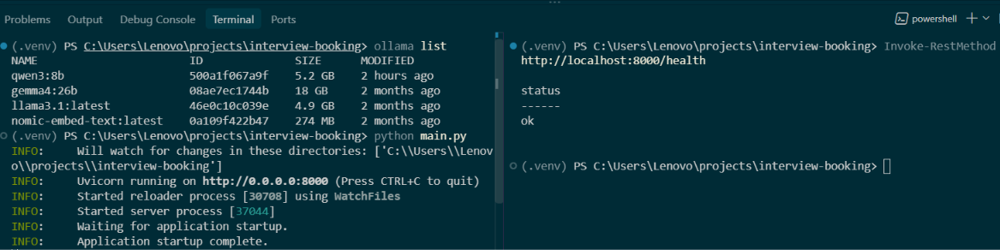
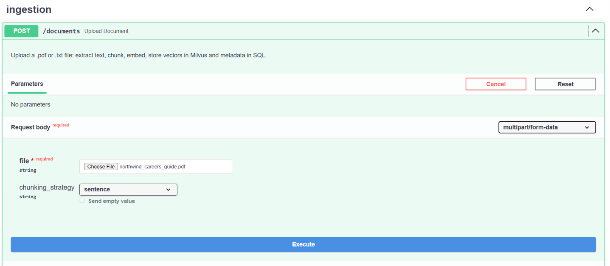
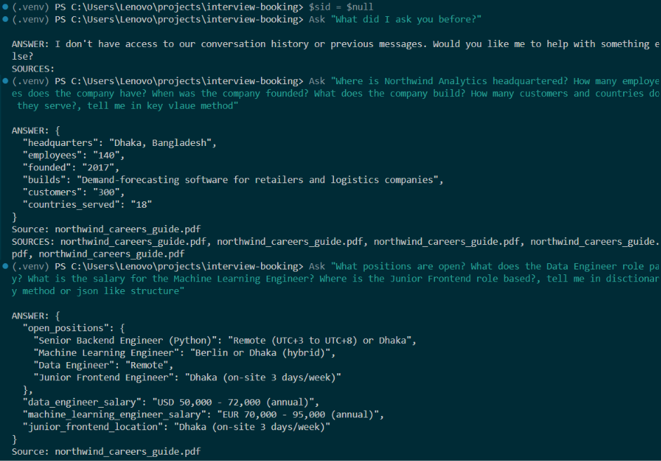
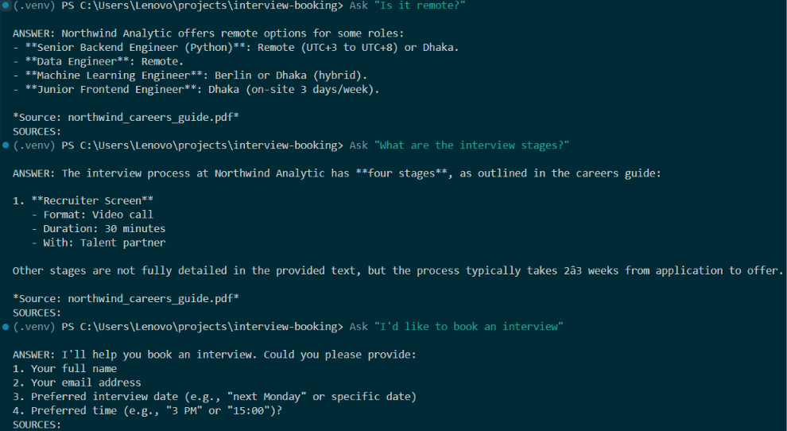
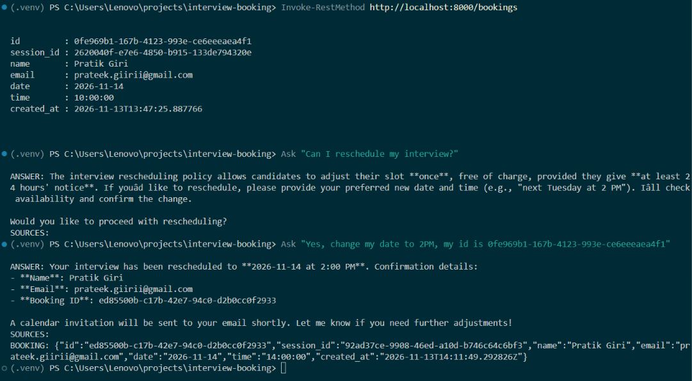

# Interview Booking RAG API

A FastAPI backend with two APIs:

1. **Document ingestion**: upload `.pdf`/`.txt` files. The service extracts the text, chunks it with one of two strategies, embeds the chunks, stores the vectors in **Milvus (Zilliz Cloud)** and saves the metadata in **SQL**.
2. **Conversational RAG**: multi-turn chat with **Redis** chat memory. It uses custom retrieval (no LangChain `RetrievalQAChain`), and the LLM can book interviews. Bookings are stored in SQL.

## Architecture

```
POST /documents ─► loader (pypdf / utf-8) ─► chunker (fixed | sentence) ─► embedder (fastembed bge-small, 384d)
                                                                         ─► Milvus  (vectors + chunk text)
                                                                         ─► SQL     (documents table)

POST /chat ─► Redis history ─► Ollama (tool-use loop) ──► search_documents ─► embed query ─► Milvus top-k
                                                       └► book_interview  ─► pydantic validation ─► SQL (bookings)
            ◄─ answer + sources + booking ◄─ append new turn to Redis
```

**Why tool calling instead of a fixed retrieve-then-generate step:** in a multi-turn chat, follow-ups like *"what about its salary range?"* make poor search queries. The model writes a standalone query from the conversation and searches only when the question needs the documents. Small talk and booking turns skip retrieval. The retrieval itself (embedding, vector search and context formatting) is plain code in `src/retrieval`.

**Booking:** the LLM collects name, email, date and time over as many turns as it needs and turns relative dates into absolute ones. It confirms the details with the user, then calls `book_interview`. The server validates the email format and rejects past dates. A unique `(date, time)` constraint prevents double-booking. When a check fails, the tool returns an error and the LLM asks the user for a correction.

## Project layout

```
main.py                     FastAPI app, logging, lifespan (creates tables)
config.yaml                 non-secret settings (models, chunk size, top_k, TTL)
.env                        secrets (see .env.example)
src/
  config.py                 pydantic-settings: config.yaml + env
  ingestion/loader.py       text extraction
  chunking/chunker.py       fixed-window and sentence-packing strategies
  embeddings/embedder.py    fastembed (local ONNX, no API key)
  vectordb/vector_store.py  Milvus client, insert/search
  retrieval/retriever.py    query → top-k passages → context string
  prompts/prompt_templates.py
  llm/llm_client.py         Ollama tool-use loop (RAG + booking)
  memory/chat_memory.py     Redis chat history per session (TTL)
  booking/service.py        booking validation + persistence
  db/models.py              SQLAlchemy models: documents, bookings
  api/routes.py, schemas.py endpoints + request/response models
  utils/helpers.py
Dockerfile                  container image (see "Run with Docker")
tests/test_app.py           offline tests (Ollama/Redis/Milvus faked)
doc/                        sample PDF for ingestion + README screenshots
logs/app.log
```

## Setup

```bash
# Ollama: install from https://ollama.com, then pull a tool-capable model
ollama pull qwen3:8b
ollama serve                                          # http://localhost:11434

python -m venv .venv && .venv\Scripts\activate      # Windows (source .venv/bin/activate elsewhere)
pip install -r requirements.txt
cp .env.example .env                                  # fill in MILVUS_URI, MILVUS_TOKEN (Ollama defaults to localhost)
docker compose up -d                                  # Redis
python main.py                                        # http://localhost:8000/docs
```



Ollama settings live in `.env` (`OLLAMA_BASE_URL`, `OLLAMA_API_KEY`); the model and sampling settings live in `config.yaml`. No Anthropic/OpenAI API key is needed.

### Environment variables (`.env`)

| Variable | Example | Notes |
|---|---|---|
| `OLLAMA_BASE_URL` | `http://localhost:11434/v1` | Ollama's OpenAI-compatible endpoint |
| `OLLAMA_API_KEY` | `ollama` | Any value; the OpenAI client requires one, Ollama ignores it |
| `MILVUS_URI` | `https://in03-xxxx.serverless.<region>.cloud.zilliz.com` | Zilliz Cloud cluster's public endpoint |
| `MILVUS_TOKEN` | `user:password` | Or a Zilliz API key |
| `REDIS_URL` | `redis://localhost:6379/0` | Local Redis from `docker compose`, or a Redis Cloud URL `redis://default:<password>@<host>:<port>` |
| `DATABASE_URL` | `sqlite:///./app.db` | Any SQLAlchemy URL (Postgres/MySQL need their driver installed) |

### Run with Docker

```bash
docker build -t interview-booking .
docker run --env-file .env -p 8000:8000 \
  -e OLLAMA_BASE_URL=http://host.docker.internal:11434/v1 \
  interview-booking
```

Inside the container, `localhost` means the container itself, so services running on your machine are reached through `host.docker.internal`. Ollama is covered by the `-e` override above. If `REDIS_URL` points at the local Redis, add `-e REDIS_URL=redis://host.docker.internal:6379/0` too. With SQLite the database file lives inside the container and is lost when the container is removed. To keep it, mount a volume (`-v ./data:/app/data` with `DATABASE_URL=sqlite:///./data/app.db`) or use a hosted database.

On first use, the embedding model (~70 MB) downloads automatically, and the Milvus collection is created if it doesn't exist.

> **Context length:** Ollama's OpenAI-compatible endpoint can't set `num_ctx`, and the default can be only 4k tokens. Set `OLLAMA_CONTEXT_LENGTH=16384` in the Ollama server environment and restart it (or build a Modelfile with `PARAMETER num_ctx 16384`) so history plus retrieved passages fit.

## Usage

**Ingest** (`chunking_strategy` = `sentence` (default) or `fixed`). A sample document is included: `doc/northwind_careers_guide.pdf`, a 4-page careers and interview guide for a fictional company.

```bash
curl -F "file=@doc/northwind_careers_guide.pdf" -F "chunking_strategy=sentence" http://localhost:8000/documents
```

On Windows PowerShell, use `curl.exe` (plain `curl` is an alias for `Invoke-WebRequest`). You can also upload from the Swagger UI at `http://localhost:8000/docs`:



**Chat**: omit `session_id` to start a conversation, then send the returned `session_id` with each later message:

```bash
curl -X POST http://localhost:8000/chat -H "Content-Type: application/json" \
  -d '{"message": "What skills does the backend role require?"}'

curl -X POST http://localhost:8000/chat -H "Content-Type: application/json" \
  -d '{"session_id": "<id>", "message": "I would like to book an interview. I am Ann Lee, ann@example.com, next Tuesday at 3pm"}'
```

The response contains `answer`, `sources` (the retrieved chunks) and `booking` (set when a booking was made).

**Bookings:** `GET /bookings`

## Example conversations

These were run against the sample PDF with `qwen3:8b`, from PowerShell.

**Questions about the company and open roles.** A new session has no memory of earlier sessions. Answers are grounded in the PDF, and each one names its source:



**Follow-up questions and the start of a booking.** The model asks for every missing booking field instead of guessing:



**Bookings and rescheduling.** `GET /bookings` lists the stored booking, and the chat answers policy questions from the guide:



## Chunking strategies

| Strategy | How it splits | Trade-off |
|---|---|---|
| `fixed` | Sliding character window (`chunk_size` 800, `chunk_overlap` 150) | Uniform sizes; may cut through a sentence, so the overlap keeps context across boundaries |
| `sentence` | Fits as many whole sentences/paragraphs as fit in `chunk_size` | Chunks stay meaningful units; sizes vary |

## Tests

```bash
pytest -q
```

These tests cover both chunking strategies, text extraction, booking validation and the chat loop: multi-turn history, searching, booking, recovering from an invalid email, double-booking and the fallback answer when the tool loop hits its limit. Ollama, Redis and Milvus are faked, so the tests need no network access.

## Notes / limits

- LLM: `qwen3:8b` via Ollama's OpenAI-compatible API (set in `config.yaml`). Ollama is free, needs no API key and keeps data on the machine. The trade-off is that an 8B model is less reliable at multi-turn tool use than a hosted model: it may call `book_interview` before you've confirmed, or misread a relative date. The server-side checks still reject invalid emails, past dates and taken slots. Because the client is OpenAI-compatible, pointing `OLLAMA_BASE_URL` and `llm.model` at a hosted endpoint switches models without code changes.
- Chat history is never trimmed; sessions expire after 24 h. For very long conversations, add compaction.
- Scanned PDFs (images only) return 422 because there is no OCR.
- SQLite is the default database. Set `DATABASE_URL` to use Postgres or MySQL; the code doesn't change.
